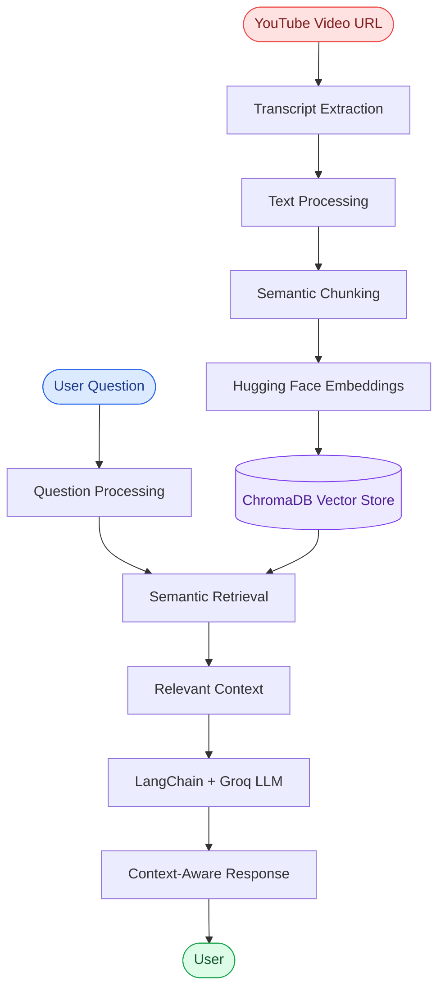
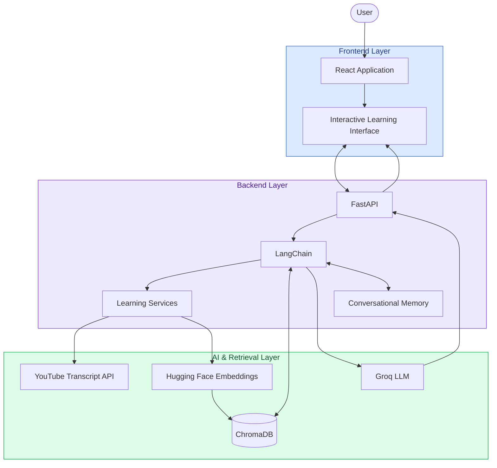

<div align="center">

# 🎓 LearnFlow AI

### Turn YouTube Lectures into Interactive Learning Experiences.

**Watch less passively. Understand more intelligently.**

LearnFlow AI is a full-stack AI-powered learning assistant that transforms YouTube video lectures into interactive learning experiences. It allows users to ask questions, explore specific timestamps, generate summaries, create study notes, and test their knowledge — all using the content of the original video.

<br/>


<br/><br/>

<a href="https://github.com/smilingstar78/LearnFlow-AI">
  
</a>

<br/><br/>

**Built with curiosity. Powered by AI. Designed for better learning.**

</div>

---

## 📖 About the Project

Ever watched a long YouTube lecture and wished you could simply ask questions about it instead of going through the entire video again?

That's the problem **LearnFlow AI** aims to solve.

LearnFlow AI is an intelligent learning assistant that converts YouTube lectures into interactive, AI-powered study sessions.

It extracts video transcripts, processes the content, generates embeddings, and stores them in a vector database. Using Retrieval-Augmented Generation (RAG), users can interact with the lecture content and receive contextually relevant answers.

But it doesn't stop at question answering.

LearnFlow AI also helps learners generate summaries, translate content, prepare study notes, create flashcards, take quizzes, and explore video chapters.

The idea is simple:

**Turn every YouTube lecture into your own interactive AI-powered classroom.**

---

## ✨ Features

<table>
<tr>
<td width="50%" valign="top">

<h3>🎥 YouTube Video Understanding</h3>

Extracts and processes YouTube video transcripts to make lecture content searchable and understandable.

</td>
<td width="50%" valign="top">

<h3>💬 RAG-Powered Chatbot</h3>

Ask questions about video content and receive AI-generated answers grounded in the retrieved transcript context.

</td>
</tr>

<tr>
<td width="50%" valign="top">

<h3>⏱️ Timestamp-Based Questions</h3>

Explore specific moments in a lecture and ask questions about what was being discussed at a particular timestamp.

</td>
<td width="50%" valign="top">

<h3>🧠 Conversational Memory</h3>

Maintains conversational context so users can ask follow-up questions naturally without repeatedly explaining the topic.

</td>
</tr>

<tr>
<td width="50%" valign="top">

<h3>📝 AI Summaries & Overviews</h3>

Generate concise summaries and structured overviews to understand lengthy lectures more efficiently.

</td>
<td width="50%" valign="top">

<h3>🌍 Content Translation</h3>

Translate learning material to make lecture content more accessible.

</td>
</tr>

<tr>
<td width="50%" valign="top">

<h3>📚 Automatic Study Notes</h3>

Generate organized study notes from video lectures for revision and better retention.

</td>
<td width="50%" valign="top">

<h3>🃏 Flashcard Generation</h3>

Create AI-generated flashcards to practice concepts and reinforce learning.

</td>
</tr>

<tr>
<td width="50%" valign="top">

<h3>❓ Interactive Quizzes</h3>

Generate quizzes based on lecture content to evaluate understanding and test knowledge.

</td>
<td width="50%" valign="top">

<h3>📑 Chapter Generation</h3>

Organize lecture content into meaningful chapters to make navigation and learning easier.

</td>
</tr>
</table>

---

## 🧠 How It Works

LearnFlow AI combines transcript processing, semantic search, vector embeddings, and LLM-powered generation to create an interactive learning experience.

### 🔄 RAG Architecture

<div align="center">



</div>

### ⚙️ Processing Pipeline

| Step | Process | Description |
|:---:|---|---|
| 01 | Transcript Extraction | Extracts transcript data from YouTube videos. |
| 02 | Text Processing | Cleans and prepares transcript content. |
| 03 | Semantic Chunking | Divides content into meaningful chunks. |
| 04 | Embedding Generation | Converts text chunks into vector representations. |
| 05 | Vector Storage | Stores embeddings in ChromaDB. |
| 06 | Semantic Retrieval | Retrieves relevant chunks based on user queries. |
| 07 | LLM Generation | Uses Groq-powered LLM inference to generate responses. |
| 08 | Response Delivery | Returns context-aware answers through the application. |

---

## 🏗️ System Architecture

LearnFlow AI follows a full-stack architecture with a React frontend and FastAPI backend.

<div align="center">



</div>

---

## 🛠️ Tech Stack

<div align="center">

### Backend & AI


<br/>

### Frontend


<br/>

### AI Ecosystem & Data


</div>

| Technology | Purpose |
|---|---|
| Python | Backend development and AI logic |
| FastAPI | REST API development |
| React | Interactive frontend |
| Vite | Frontend development tooling |
| LangChain | LLM integration and RAG orchestration |
| Groq | Fast LLM inference |
| ChromaDB | Vector storage and semantic retrieval |
| Hugging Face | Text embedding generation |
| YouTube Transcript API | Video transcript extraction |
| Docker | Containerization and deployment workflows |

---

## 📂 Project Structure

```text
LearnFlow-AI/
│
├── main.py                  # Application entry point
│
├── api/                     # FastAPI routes and endpoints
│
├── features/                # Learning features
│   ├── summarization/
│   ├── translation/
│   ├── notes/
│   ├── flashcards/
│   ├── quizzes/
│   └── chapters/
│
├── services/                # Core AI and RAG services
│   ├── transcript_service/
│   ├── embedding_service/
│   └── retrieval_service/
│
├── memory/                  # Conversational memory
│
├── utils/                   # Helper functions
│
├── frontend/                # React + Vite application
│   ├── src/
│   ├── public/
│   └── package.json
│
├── requirements.txt         # Python dependencies
├── Dockerfile               # Container configuration
└── README.md
```

---

## 🚀 Getting Started

Follow these steps to set up LearnFlow AI locally.

### Prerequisites

Make sure you have the following installed:

- Python 3.10+
- Node.js and npm
- Git
- Groq API Key

### 1. Clone the Repository

```bash
git clone https://github.com/smilingstar78/LearnFlow-AI.git
```

### 2. Navigate to the Project

```bash
cd LearnFlow-AI
```

### 3. Set Up the Backend

Create a virtual environment:

```bash
python -m venv venv
```

Activate the environment.

**Windows:**

```bash
venv\Scripts\activate
```

**Linux / macOS:**

```bash
source venv/bin/activate
```

Install dependencies:

```bash
pip install -r requirements.txt
```

### 4. Configure Environment Variables

Create a `.env` file in the project root:

```env
GROQ_API_KEY=your_groq_api_key
```

Add any additional environment variables required by your configuration.

**Important:** Never expose API keys or commit your `.env` file to GitHub.

### 5. Start the Backend

```bash
uvicorn main:app --reload
```

The backend should be available at:

```text
http://127.0.0.1:8000
```

FastAPI interactive documentation:

```text
http://127.0.0.1:8000/docs
```

### 6. Set Up the Frontend

Open another terminal:

```bash
cd frontend
```

Install dependencies:

```bash
npm install
```

Start the development server:

```bash
npm run dev
```

Open the local URL displayed in your terminal to access the frontend.

---

## 🐳 Docker Support

LearnFlow AI also uses Docker as part of its containerization and deployment workflow.

Build the Docker image:

```bash
docker build -t learnflow-ai .
```

Run the container:

```bash
docker run -p 8000:8000 --env-file .env learnflow-ai
```

Make sure your Docker configuration exposes the correct application port and starts the appropriate backend service.

---

## 🎯 What Makes LearnFlow AI Different?

Traditional video learning usually requires learners to:

- Rewatch lengthy lectures to find specific information.
- Manually prepare notes and summaries.
- Search through videos to understand individual concepts.
- Create their own revision material.
- Spend additional time preparing for assessments.

LearnFlow AI brings these learning activities together in one AI-powered application.

Rather than building just another chatbot, the project combines:

- Retrieval-Augmented Generation (RAG).
- Semantic chunking and vector embeddings.
- Context-aware conversational memory.
- Full-stack frontend and backend integration.
- Multiple AI-powered learning utilities.

**The objective is to make learning more interactive, personalized, and efficient.**

---

## 🔮 Future Enhancements

- [ ] Support for additional video and educational content sources.
- [ ] Improved timestamp navigation and video synchronization.
- [ ] Personalized learning recommendations.
- [ ] Advanced quiz evaluation and performance analytics.
- [ ] Progress tracking and learning history.
- [ ] Improved conversational memory.
- [ ] Multilingual learning support.
- [ ] Enhanced study plans and revision scheduling.

---

## 👩🏻‍💻 About the Developer

<div align="center">

### Muskan Tariq

**AI Engineer | Generative AI | Agentic AI**

BS Artificial Intelligence

The Islamia University of Bahawalpur

<br/>

I enjoy building intelligent applications that solve practical problems using Machine Learning, Generative AI, Retrieval-Augmented Generation, and Agentic AI.

LearnFlow AI represents my exploration of taking AI concepts beyond isolated experiments and integrating them into a complete, user-focused application.

<br/>

<a href="https://github.com/smilingstar78">
  
</a>

<a href="https://www.linkedin.com/in/muskan-tariq-095a50282/">
  
</a>

<!-- Replace the placeholder URLs below with your actual profile links -->

<a href="YOUR_INSTAGRAM_URL">
  
</a>

<a href="YOUR_YOUTUBE_CHANNEL_URL">
  
</a>

<a href="https://muskan-tariq-portfolio.vercel.app/">
  
</a>

</div>

---

<div align="center">

## 💜 A Little More About LearnFlow AI

**Learning should be an experience, not just a process of watching and remembering.**

If you find this project interesting, don't forget to ⭐ the repository!

<br/>


<br/><br/>

**LearnFlow AI — Learn Smarter. Explore Deeper.**

</div>
